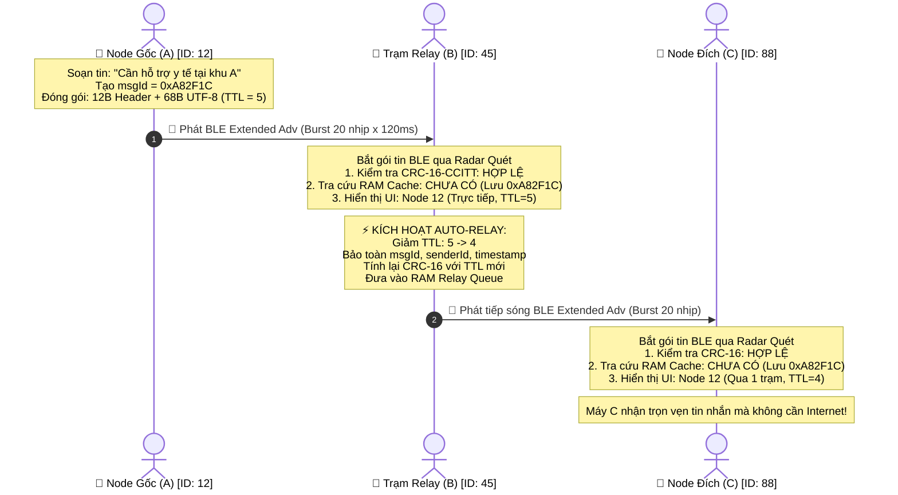
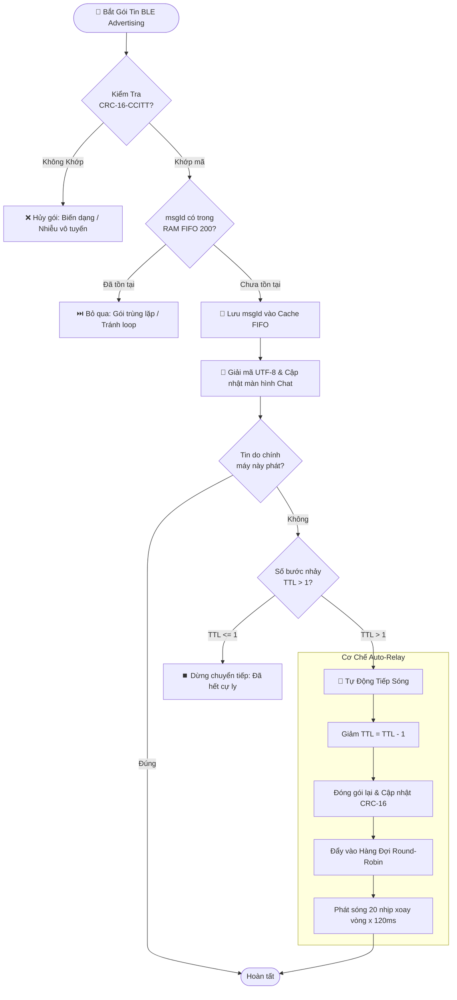

<div align="center">

# 📡 ZEROCHAT
### Decentralized Connectionless BLE 5.0+ Mesh Network
**Hệ Thống Nhắn Tin Vô Tuyến Ngoại Tuyến Phân Tán — Chuẩn Bluetooth 5.0 Extended Advertising (254B)**

[](https://reactnative.dev/)
[](https://expo.dev/)
[](https://www.bluetooth.com/)
[-3DDC84?style=for-the-badge&logo=android&logoColor=white)](https://developer.android.com/)
[](https://developer.apple.com/ios/)
[](LICENSE)
[](#-cấu-trúc-mã-nguồn-modular-architecture)

<br/>

> 🚀 **"Giao tiếp tức thời khi Internet, 4G/5G, cáp quang và lưới điện viễn thông ngừng hoạt động."**  
> Xây dựng hoàn toàn bằng **Pure JavaScript ES6+**, hoạt động theo cơ chế **Store-and-Forward RAM Cache** tự động chuyển tiếp đa bước nhảy (Multi-Hop Auto-Relay) không cần Pair hay GATT Connection.

<br/>

[✨ Tính Năng Nổi Bật](#-tính-năng-nổi-bật) •
[📐 Kiến Trúc Multi-Hop](#-kiến-trúc-mạng-store-and-forward) •
[🔬 Gói Tin Nhị Phân](#-đặc-tả-khung-gói-tin-nhị-phân-240-bytes) •
[🏗️ Cấu Trúc Modular](#-cấu-trúc-mã-nguồn-modular-architecture) •
[📱 Giao Diện & Tech Mode](#-giao-diện-và-chế-độ-kỹ-thuật) •
[☁️ Hướng Dẫn Build APK](#-hướng-dẫn-cài-đặt--biên-dịch-build) •
[🗺️ Lộ Trình](#-lộ-trình-phát-triển)

---

</div>

<br/>

## 🌟 Tính Năng Nổi Bật

| Tính năng cốt lõi | Chi tiết kỹ thuật | Lợi ích thực tiễn |
| :--- | :--- | :--- |
| **🚫 Không Ghép Đôi (Connectionless)** | Dùng trực tiếp **BLE Advertising PDU** (Không GATT, không bắt tay). | Gửi tin 1-tới-vô-số thiết bị tức thì, triệt tiêu độ trễ kết nối 3–10s của Bluetooth truyền thống. |
| **📦 Bluetooth 5.0 Extended Adv** | Mở rộng dung lượng PDU từ 31 Bytes (BLE 4.x) lên **240–254 Bytes**. | Truyền trọn vẹn văn bản tiếng Việt có dấu dài **180–200 ký tự** trong 1 khung phát sóng đơn lẻ. |
| **🔄 Auto-Relay Tự Động** | Thiết bị trung gian đóng vai trò trạm lặp (Repeater) tự động. | Mở rộng cự ly liên lạc từ vài chục mét lên hàng trăm mét qua chuỗi thiết bị trung chuyển. |
| **🛡️ Khử Trùng Lặp & Chống Bão** | RAM FIFO 200 Message IDs kết hợp TTL (Time-To-Live) giảm dần. | Ngăn chặn hiện tượng bão phát sóng (**Broadcast Storm**) và bảo toàn tài nguyên bộ nhớ/pin. |
| **🔒 Kiểm Lỗi CRC-16-CCITT** | Thuật toán băm đa thức viễn thông `0x1021` (Initial `0xFFFF`). | Lọc bỏ 100% các gói tin biến dạng do nhiễu môi trường sóng 2.4GHz trước khi đưa lên UI. |
| **⏱️ Round-Robin Scheduler** | Bộ lập lịch phát xung nhịp chuẩn **120ms / pulse**, chuỗi 20 nhịp. | Tối ưu hóa chu kỳ làm việc (Duty Cycle) của chip Bluetooth, giảm tiêu hao năng lượng. |
| **📊 Tech Inspector & Monitor** | Thanh Live RAM Cache Monitor & Modal giải phẫu từng Byte dữ liệu. | Minh bạch hóa toàn bộ luồng dữ liệu nhị phân, phục vụ báo cáo đồ án và kiểm thử thực địa. |

---

## 📐 Kiến Trúc Mạng (Store-and-Forward)

Khác với mô hình Client-Server hoặc kết nối điểm-điểm (P2P GATT Connection), Zerochat triển khai mô hình **Mạng Lưới Tự Tổ Chức Không Dây (Wireless Ad-hoc Mesh)** dựa trên nguyên lý **Store-and-Forward**:



### 🔁 Lưu Đồ Xử Lý Gói Tin Tại Mỗi Nút (Node Packet Pipeline)



---

## 🔬 Đặc Tả Khung Gói Tin Nhị Phân (240 Bytes)

Mỗi gói tin được mã hóa ở mức byte trần (`Uint8Array`, `DataView`, `Buffer`) nhằm triệt tiêu overhead của JSON hoặc Protobuf:

```
 0                   1                   2                   3
 0 1 2 3 4 5 6 7 8 9 0 1 2 3 4 5 6 7 8 9 0 1 2 3 4 5 6 7 8 9 0 1
+-+-+-+-+-+-+-+-+-+-+-+-+-+-+-+-+-+-+-+-+-+-+-+-+-+-+-+-+-+-+-+-+
|                    Message ID (32-bit Uint32)                 |
+-+-+-+-+-+-+-+-+-+-+-+-+-+-+-+-+-+-+-+-+-+-+-+-+-+-+-+-+-+-+-+-+
|   Sender ID   |      TTL      |       Timestamp (32-bit       |
+-+-+-+-+-+-+-+-+-+-+-+-+-+-+-+-+-+-+-+-+-+-+-+-+-+-+-+-+-+-+-+-+
|       Unix Epoch Seconds)     |      CRC-16-CCITT (16-bit)    |
+-+-+-+-+-+-+-+-+-+-+-+-+-+-+-+-+-+-+-+-+-+-+-+-+-+-+-+-+-+-+-+-+
|                                                               |
+                    Text Payload (UTF-8 Buffer)                +
|                   Tối đa 220 Bytes (~180-200 Ký tự)           |
|                                                               |
+-+-+-+-+-+-+-+-+-+-+-+-+-+-+-+-+-+-+-+-+-+-+-+-+-+-+-+-+-+-+-+-+
```

### Chi tiết các trường dữ liệu:

| Offset (Byte) | Độ dài | Kiểu dữ liệu | Tên trường | Chức năng kỹ thuật |
| :---: | :---: | :---: | :---: | :--- |
| **`0 - 3`** | 4B | `Uint32` BE | `msgId` | Mã băm định danh duy nhất của gói tin, dùng làm khóa chống lặp trong RAM. |
| **`4`** | 1B | `Uint8` | `senderId` | Node ID của máy soạn tin gốc (`10` đến `99`). |
| **`5`** | 1B | `Uint8` | `ttl` | Time-To-Live. Khởi tạo mặc định = `5`. Giảm 1 qua mỗi trạm trung gian. |
| **`6 - 9`** | 4B | `Uint32` BE | `timestamp` | Thời gian tạo gói (Unix epoch seconds) phục vụ sắp xếp thứ tự tin nhắn. |
| **`10 - 11`** | 2B | `Uint16` BE | `checksum` | **CRC-16-CCITT** tính trên toàn bộ `textPayload` để bảo toàn dữ liệu. |
| **`12 - 239`**| Max 220B | Raw UTF-8 | `textPayload` | Văn bản tiếng Việt có dấu. Tự động cắt theo ranh giới ký tự nếu vượt ngưỡng. |

---

## 🏗️ Cấu Trúc Mã Nguồn (Modular Architecture)

Dự án được phân rã thành các module độc lập theo nguyên tắc **Clean Architecture & SOLID**, giúp lập trình viên và AI Agent nắm bắt toàn bộ logic trong 30 giây:

```
Zerochat/
├── 📁 src/
│   ├── 📁 bleMeshEngine/             # 🧠 Lõi xử lý Mạng Mesh BLE
│   │   ├── 📄 config.js             # Toàn bộ hằng số hệ thống (UUID, 120ms, 220B, FIFO 200)
│   │   ├── 📄 codec.js              # Xử lý nhị phân: CRC-16, DataView, Encode/Decode, UTF-8 Chunking
│   │   ├── 📄 cacheStore.js         # Quản lý RAM Cache FIFO 200, Deduplication, Relay Round-Robin
│   │   └── 📄 index.js              # Facade Module tập trung toàn bộ API công khai
│   ├── 📄 bleMeshEngine.js          # Re-export Proxy bảo toàn tính tương thích ngược
│   └── 📁 components/               # Các UI components giao diện
├── 📁 scripts/
│   ├── 📄 patch-ble-advertiser.js   # Script tự động vá SDK 34 & AGP Namespace cho native module
│   └── 📄 reset-project.js
├── 📄 App.js                        # Giao diện chính Dark Theme, Radar BLE, Tech Mode, Inspector
├── 📄 app.json                      # Cấu hình Expo, quyền Android 14 & iOS CoreBluetooth
├── 📄 eas.json                      # Cấu hình EAS Build APK tự động trên đám mây
├── 📄 package.json                  # Dependencies & lifecycle hooks (postinstall)
└── 📄 README.md                     # Tài liệu kỹ thuật chi tiết
```

---

## 📱 Giao Diện và Chế Độ Kỹ Thuật

```
+-------------------------------------------------------------+
| [● Sẵn sàng ngoại tuyến]      📡 ZEROCHAT MESH      (Node #42) |
+-------------------------------------------------------------+
| [⚙️ KỸ THUẬT: BẬT]  [+ THỬ NHẬN TIN DÀI]                      |
|                                                             |
| ┌── 🧠 BỘ NHỚ ĐỆM CHUYỂN TIẾP (STORE-AND-FORWARD) ────────┐ |
| │ Đang phát: msg_0xA82F1C [████████████░░░░░░░░] Nhịp 12/20 │ |
| │ Hàng đợi: 2 gói tin trong RAM | Đã lưu: 37 IDs chống bão  │ |
| └───────────────────────────────────────────────────────────┘ |
|                                                             |
|  [Node #12]                                                 |
|  ┌────────────────────────────────────────────────────────┐ |
|  │ Cần hỗ trợ y tế tại khu dân cư A, mất điện toàn bộ!    │ |
|  └────────────────────────────────────────────────────────┘ |
|   10:42 • 🔵 Qua 1 trạm trung gian (~20-50m) • 74 Bytes      |
|                                                             |
|                                  [Bạn - Node #42]           |
|                                 ┌─────────────────────────┐ |
|                                 │ Đội cứu hộ đang đến!    │ |
|                                 └─────────────────────────┘ |
|                                  10:43 • 🟢 Đang phát 20/20 │
+-------------------------------------------------------------+
| [ Nhập tin nhắn cần gửi qua BLE Mesh...        ] [ 🚀 GỬI ]  |
+-------------------------------------------------------------+
```

### Các công cụ chuyên sâu tích hợp sẵn:
1. **Live Cache Monitor:** Giám sát trực tiếp hàng đợi chuyển tiếp RAM, mã gói tin dạng Hex, và tiến trình nhịp phát 120ms xoay vòng.
2. **Packet Inspector Modal:** Chạm vào bất kỳ tin nhắn nào để "mổ xẻ" chi tiết: Độ dài nhị phân thực tế, mã băm CRC-16, phân tích bước nhảy TTL và luồng định tuyến.
3. **Bộ Giả Lập Đa Kịch Bản (`+ Thử nhận tin dài`):** Cho phép kiểm thử tin nhắn dài 140–180 ký tự tiếng Việt và cơ chế Auto-Relay ngay trên 1 máy đơn lẻ mà không cần nhiều điện thoại.

---

## ☁️ Hướng Dẫn Cài Đặt & Biên Dịch (Build)

Do ứng dụng can thiệp trực tiếp vào chip vô tuyến Bluetooth phần cứng thông qua `react-native-ble-plx` và `react-native-ble-advertiser` (Extended Advertising PDU), **ứng dụng bắt buộc phải build Native** (không thể chạy qua Expo Go tiêu chuẩn).

---

### 🚀 Cách 1: Build file APK qua EAS Cloud (Khuyên dùng — Không cần cài JDK)

Dự án đã được tích hợp sẵn script tự động vá lỗi native module và chứng chỉ ký APK trên máy chủ đám mây của Expo:

```bash
# 1. Đăng nhập tài khoản Expo (đã tạo)
npx eas-cli login

# 2. Khởi chạy tiến trình đóng gói APK tự động
npx eas-cli build --platform android --profile preview
```

> ⏱️ Sau 3–5 phút, EAS sẽ trả về đường dẫn tải trực tiếp file `.apk` và mã QR để quét cài đặt lên điện thoại Android.

---

### 💻 Cách 2: Biên Dịch APK Nội Bộ (Local Android Build)

Yêu cầu môi trường: **JDK 17** (Temurin/OpenJDK) và **Android Studio SDK 34 (API 34)**.

```powershell
# 1. Cài đặt các gói phụ thuộc (sẽ tự động chạy script vá SDK)
npm install

# 2. Sinh thư mục native Android sạch
npx expo prebuild --platform android --clean

# 3. Biên dịch file APK bằng Gradle (PowerShell Windows)
cd android
.\gradlew.bat assembleDebug

# File APK hoàn thành tại:
# android/app/build/outputs/apk/debug/app-debug.apk
```

---

### 🌐 Cách 3: Chạy Web Simulator (Thử nghiệm ngay trên máy tính)

Ứng dụng tích hợp bộ mô phỏng Web Engine cho phép bạn trải nghiệm giao diện và luồng dữ liệu Store-and-Forward ngay trên trình duyệt mà không cần điện thoại:

```bash
npx expo start --web
```
*Nhấn phím `w` trong terminal để mở trình duyệt tại `http://localhost:8081`.*

---

## 📋 So Sánh Các Giải Pháp Giao Tiếp Ngoại Tuyến

| Tiêu chí | 📡 Zerochat (BLE 5.0 Mesh) | 📶 Bluetooth GATT Truyền Thống | 📻 Bộ Đàm Analog (RF) |
| :--- | :---: | :---: | :---: |
| **Yêu cầu Internet / Sóng điện thoại** | ❌ Không | ❌ Không | ❌ Không |
| **Thao tác kết nối / Ghép đôi** | **Hoàn toàn tự động (Zero-click)** | Thủ công (Pairing PIN/Wait) | Phải dò đúng kênh tần số |
| **Mô hình truyền thông** | **1-tới-Nhiều (Mesh Broadcast)** | 1-tới-1 (P2P Point-to-Point) | 1-tới-Nhiều (Kênh công cộng) |
| **Độ trễ truyền tin** | **< 150ms** | 3.000ms – 10.000ms | Tức thời |
| **Truyền tiếp qua nhiều chặng (Relay)** | **Có (Store-and-Forward)** | Rất phức tạp / Thường không có | Cần trạm Repeater cố định |
| **Tiêu hao năng lượng (Pin)** | **Cực thấp (BLE Duty Cycle)** | Trung bình | Rất cao |
| **Bảo toàn tính toàn vẹn** | **CRC-16-CCITT Checksum** | CRC Link Layer | Rất dễ rè / Mất tín hiệu |

---

## 🗺️ Lộ Trình Phát Triển (Roadmap)

- [x] **Giai đoạn 1 (Hiện tại):** Hoàn thiện lõi BLE 5.0 Extended Advertising (254B), CRC-16-CCITT, Store-and-Forward RAM Cache FIFO 200, Auto-Relay.
- [ ] **Giai đoạn 2:** Mã hóa đầu cuối bất đối xứng (E2EE) sử dụng cặp khóa **ECDH X25519** kết hợp mật mã đối xứng dòng **ChaCha20-Poly1305** (Bảo vệ nội dung tin nhắn riêng tư).
- [ ] **Giai đoạn 3:** Hỗ trợ nén giọng nói ngắn dạng Push-to-Talk ngoại tuyến sử dụng codec âm thanh siêu nén **Opus / Codec2** (100–200 bytes/chunk).
- [ ] **Giai đoạn 4:** Thuật toán định tuyến bản đồ định hướng (Geo-Mesh Routing) dựa trên tọa độ GPS ngoại tuyến.

---

## 📄 Bản Quyền & Giấy Phép

Dự án được phân phối dưới giấy phép **MIT License**. Bạn được toàn quyền sử dụng, sửa đổi và tích hợp vào các dự án cứu hộ, nghiên cứu khoa học hoặc thương mại.

<div align="center">
  <b>Phát triển vì cộng đồng • Sẵn sàng trong mọi tình huống khẩn cấp 🇻🇳</b>
</div>
